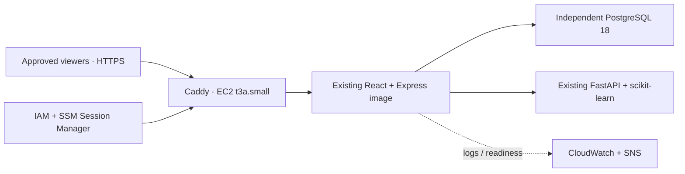

# AegisED — Escape Velocity staging approval package

**Status: prepared locally, not deployed. Owner approval is required before any AWS create/update command.**

Source reviewed: `YT-PRO12/AegisED`, commit `d5309e6f1dcfe88b999442de16ce86e4a90d1d72`. These files are additive and do not modify application code, the existing Dockerfiles, root Compose, Render, Neon, DNS, or production credentials. One stale `tatus --short` manifest entry was removed because it prevents current CI from reaching application tests. The production URL in the root README is `https://careflow-app.onrender.com`; an older deployment document has a conflicting hostname. Neither is used by this staging setup.

## Proposed architecture



One x86 EC2 host in a new VPC in **ap-southeast-2**, with encrypted 40 GiB gp3, 2 vCPU, 2 GiB RAM and 2 GiB encrypted-disk swap. Builds run sequentially. Four memory-limited containers share the host: API 384 MiB, ML 512 MiB, DB 384 MiB, proxy 128 MiB. These are initial low-traffic demo limits, not measured capacity guarantees. Observe RAM, swap and latency before any public demo; request separate approval before resizing. No GPU, Ollama or external generative-model service is needed.

PostgreSQL and ML have no published ports and use an internal Docker network. Only Caddy receives internet traffic. The security group permits HTTP for certificate issuance and HTTPS from an explicitly selected CIDR; no SSH, 5000, 5432 or 8000 ingress. Access through SSM avoids SSH keys. IMDSv2 is required, hop limit is one, and the host blocks container access to metadata. Instance permissions cover SSM, the staging log group and one metric namespace; no production database, DNS, deployment, secret-store or account-administration access is granted to the app host. Outbound host access is permitted for updates, package downloads, ACME and AWS APIs.

Production-mode Express already enforces HTTPS cookies, CSRF, RBAC and origin checks. `APP_ORIGIN` must match a **new staging hostname**; one trusted Caddy hop is configured. New independent secrets are generated on the host with mode 0600 and never placed in Git, user data, CloudFormation parameters or logs. The database URL is hard-wired to the internal staging container. Synthetic seeding is explicit and idempotent. Do not enter real patient data: this is an educational decision-support prototype, not a clinically validated system.

This is a single-host staging environment: host failure affects all services. The database volume survives container replacement and host stop/start, but **instance termination or stack deletion destroys it**. There is no high availability or automatic off-host backup. Production retains its existing Render + Neon architecture.

## Cost and approval scope

All amounts USD, before tax; 730-hour month; no credits/free-tier discounts assumed. EC2/EBS rates were fetched from AWS's Sydney price list on 2026-10-13, effective 2026-10-01; exact SKUs and source are in [pricing.json](pricing.json).

| Item | Estimate |
|---|---:|
| t3a.small, Linux on-demand, CPU credit mode **standard** | $0.0238/hour; $17.37/month |
| 40 GiB gp3, baseline IOPS/throughput | $3.84/month |
| One Elastic/public IPv4 | $0.005/hour; $3.65/month |
| Four custom metrics, six standard alarms, modest logs/SNS/API usage | Plan $3/month |
| Low demo traffic/transfer allowance | Plan $2/month |
| **24/7 planning total** | **About $30/month** |
| Host running 8 hours/day for 30 days | **About $18/month**, including the same conservative allowances |

The $3 monitoring and $2 transfer figures are allowances, not fixed charges or caps. Keep log ingestion below approximately 1 GB/month and review actual charges. No paid domain, Route 53 zone, ALB, NAT gateway, RDS, S3, ECR, Kubernetes or paid support is included. Use an existing domain's new subdomain at its existing DNS provider. Elastic IP and disk continue charging while the host is stopped: approximately $7.49/month plus monitoring. CPU standard mode prevents surplus-credit charges but throttles sustained work. Optional snapshots and extra outbound traffic cost extra.

Local Postgres has no additional service fee and strongest isolation from production credentials. A **new** Neon project could reduce host pressure but introduces another external staging dependency and unverified plan limits. A separate RDS database adds instance and storage charges; it is not needed for this disposable single-host demo and is excluded from the approved design. No production Neon branch/database is reused.

Official price references: [EC2 regional price data](https://pricing.us-east-1.amazonaws.com/offers/v1.0/aws/AmazonEC2/current/ap-southeast-2/index.csv), [public IPv4](https://aws.amazon.com/vpc/pricing/), [CloudWatch](https://aws.amazon.com/cloudwatch/pricing/), [SSM](https://aws.amazon.com/systems-manager/pricing/).

Proposed approval: one staging stack, resources exactly described here, a **$40 gross-spend experiment ceiling**, with notifications at $20/$30/$40 and forecast $40. Budget notifications are delayed and **do not stop spending**. The budget is account-wide and excludes credits/refunds, intentionally avoiding inactive cost-allocation-tag filters; it may include other account workloads. No automatic destructive budget action is configured. Check spend daily and stop early if the forecast exceeds the ceiling. A credit balance of roughly $120 is owner-reported, not verified. Billing-plan eligibility, expiry, service coverage and any Free-to-Paid upgrade need separate confirmation. No upgrade is authorized by this package.

Before creation, confirm: approved spending scope, AWS account/role via SSO or CloudShell, new staging hostname, viewer IPv4 CIDR, and alert email. Never paste credentials into chat. There is no AWS CLI/authenticated AWS connection in the current preparation workspace.

## Deployment after explicit approval

Use an AWS CLI session authenticated with SSO or the owner's CloudShell. Confirm the account using `aws sts get-caller-identity`; verify credits/plan in Billing and confirm `t3a.small` availability/quota in Sydney. Do not select a larger instance or new paid plan automatically. The deployment identity needs CloudFormation and the EC2/VPC, IAM/PassRole, Logs, CloudWatch, SNS and Budgets permissions represented by this template; the instance role is separate and narrower.

From the reviewed branch checkout, validate and create a **change set without execution**:

```bash
aws cloudformation validate-template --region ap-southeast-2 \
  --template-body file://infra/aws-staging/template.yaml
aws cloudformation deploy --region ap-southeast-2 \
  --stack-name aegised-staging \
  --template-file infra/aws-staging/template.yaml \
  --capabilities CAPABILITY_IAM \
  --tags Project='Escape Velocity' Environment=staging \
  --parameter-overrides HttpsClientCidr=YOUR_PUBLIC_IP/32 AlertEmail=YOUR_EMAIL \
  --no-execute-changeset
```

Review the returned change-set ARN with `describe-change-set`. **Only after approval**, execute that exact change set and wait for stack completion. Stack completion only proves AWS resource creation; user-data/application success is checked separately. Obtain `InstanceId`, `PublicIp`, `LogGroup` from `describe-stacks`. Confirm the SNS email subscription. Point only the new staging hostname's DNS A record to `PublicIp`; do not change existing Render/Neon records. Avoid stale AAAA records. Do not reuse a production hostname.

Connect with `aws ssm start-session --region ap-southeast-2 --target INSTANCE_ID` (local CLI requires Session Manager plugin; CloudShell/console alternatives are available). In the instance session:

```bash
sudo cloud-init status --wait
sudo docker compose version
sudo systemctl status aegised-metadata-guard --no-pager
sudo git clone --branch staging/aws-escape-velocity --single-branch \
  https://github.com/YT-PRO12/AegisED.git /opt/aegised
cd /opt/aegised
# Before installing, checkout the exact reviewed PR commit, not a moving branch.
sudo git checkout REVIEWED_COMMIT_SHA
sudo python3 infra/aws-staging/configure.py \
  --domain staging.YOUR_DOMAIN --email YOUR_EMAIL \
  --log-group /aegised-staging/aegised-staging
sudo bash infra/aws-staging/install.sh
```

Use lowercase domain names. The configuration generator refuses to overwrite secrets; don't delete a populated database's configuration or regenerate its password. Image tags currently follow the existing Postgres major and Caddy major; record the resolved image digests with `docker image inspect` as deployment evidence. Routine deployment must use the reviewed source commit. On build/bootstrap errors, inspect `/var/log/cloud-init-output.log` or container logs, fix staging only, and do not claim a working deployment.

## Independent acceptance and evidence

1. From a separate permitted client, run `python3 infra/aws-staging/smoke.py https://STAGING_DOMAIN`. This verifies trusted HTTPS, frontend, API liveness, a DB query, and anonymous denial. It does not prove ML, login or transactions.
2. Retrieve `backend/.demo-credentials` only within the authorized SSM session using `sudo docker compose -f infra/aws-staging/compose.yaml exec api cat .demo-credentials`. Keep it private. Run smoke again with local `STAGING_TEST_EMAIL` / `STAGING_TEST_PASSWORD` entered privately; run once as admin and once as reception. It checks secure cookie attributes, authenticated ML status for admin, non-admin denial and logout. Never include passwords in command arguments, screenshots or reports.
3. In the browser use synthetic records: register, create emergency case, generate assistive prediction, review/override with a reason, assign doctor/bed, start/complete treatment, discharge, and confirm resources released and audit entries present. Verify reception cannot allocate resources or access admin pages. Test knowledge sources and abstention. All ML advice must remain human-reviewed.
4. Run existing native PostgreSQL integration/concurrency tests in CI's disposable `AegisED_test` database. Do not point test scripts at production or the persistent staging database. A passing CI run is required before the deployment is signed off.
5. Save one synthetic record ID; `docker compose restart`; confirm the same ID, data, login and ML still work. Then verify an EC2 stop/start when permitted, keeping the Elastic IP. Observe `docker stats`, CPU credits, memory and disk metrics during the workflow. Check CloudWatch log delivery, alarm states and confirmed SNS delivery. Internal readiness metrics do not check Caddy/TLS; the external smoke test does.
6. Export a staging-only logical dump before changes: `sudo docker compose -f infra/aws-staging/compose.yaml exec -T db pg_dump -U AegisED_staging -d AegisED_staging -Fc > /tmp/aegised-staging.dump`. Protect it with mode 0600, move it to authorized private storage, and test restore in a separate disposable DB. Same-host files are not disaster recovery. No automatic backup service is included.
7. Record reviewed commit, image digests, timestamp, region, health checks, role/transaction results, restart persistence, monitoring evidence and actual gross spend. Redact account identifiers, credentials and session cookies. Do not describe AWS as live or resume-ready until these checks pass.

## Stop, resume, cleanup

After approval, use `aws ec2 stop-instances --region ap-southeast-2 --instance-ids INSTANCE_ID` outside demo windows; resume with `start-instances`. Stopped hosts retain EBS/EIP charges, and readiness alarms will report missing telemetry. Starting an instance is billable. No unattended start schedule is configured. Restart policies and the systemd timer restore services on boot; verify externally each time.

When the owner authorizes disposal, take any needed synthetic-data dump and remove the staging DNS A record. Delete only `aegised-staging` using CloudFormation, then wait for deletion and inspect any failed deletions. This removes the host/root disk (including DB), Elastic IP, staging networking/IAM, logs, alarms, budget and SNS topic. Verify no tagged volumes, snapshots or addresses remain; manually created backups/snapshots are outside the stack. Do not run cleanup against Render, Neon or another stack. Deleting the stack also deletes its budget notifications, so verify the final bill afterward.

## Local validation limits

Verified on 2026-10-13: CloudFormation lint; Compose v2.39.4 configuration validation; ShellCheck on install, monitor and EC2 bootstrap; Python syntax; fresh-secret generation with 0600 permissions; overwrite, production-hostname and newline-injection rejection; source-manifest verification (165 listed source files); repository hygiene (177 files scanned, no findings); and whitespace checks. Existing backend dependencies install successfully using `npm ci`. These checks establish preparation quality, not a running AWS deployment.

CloudFormation lint, Compose schema validation, shell analysis, Python syntax and secret-generation checks can run without AWS. No Docker daemon is available in this preparation environment, so full image boot and actual memory requirements must be verified on the approved host. AWS resource creation, HTTPS issuance, SSM connectivity, credential eligibility, live workflow acceptance and cloud monitoring have **not** been verified here.
